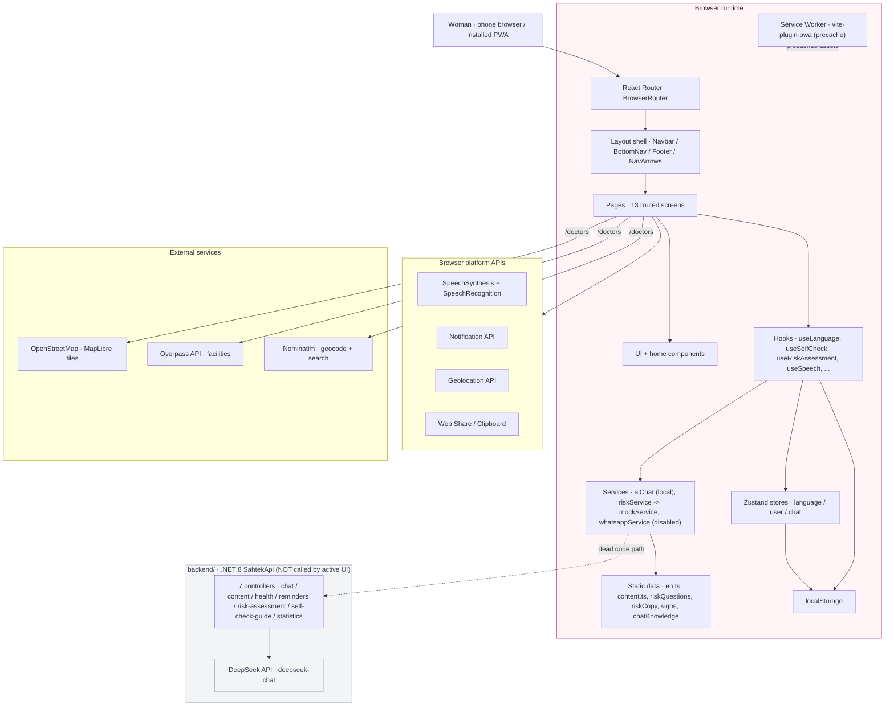
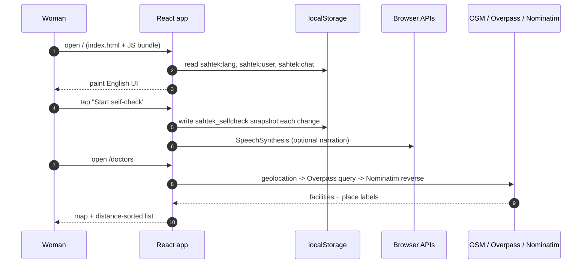
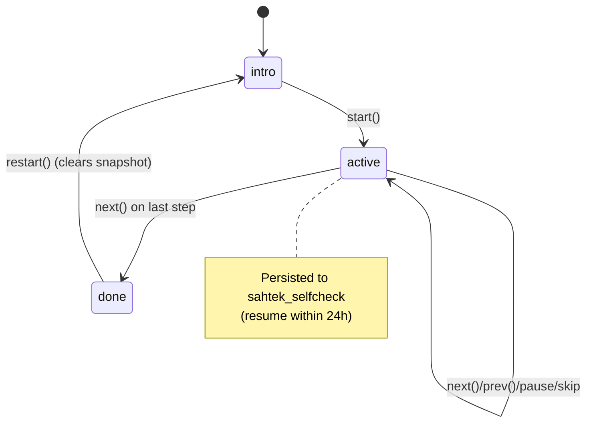
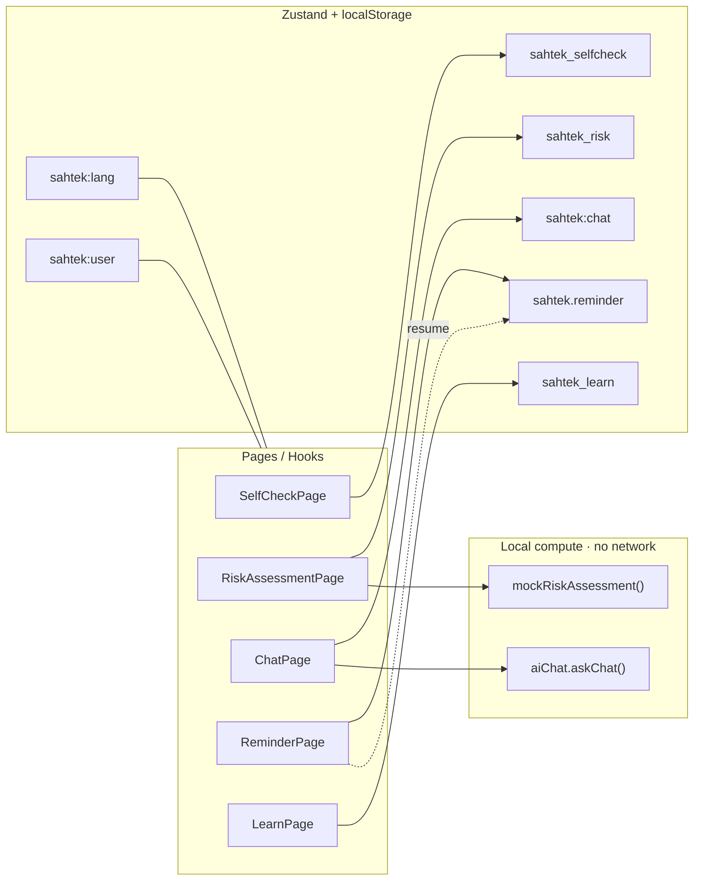
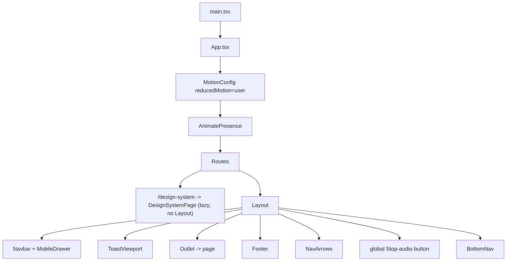
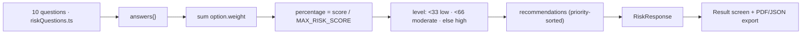
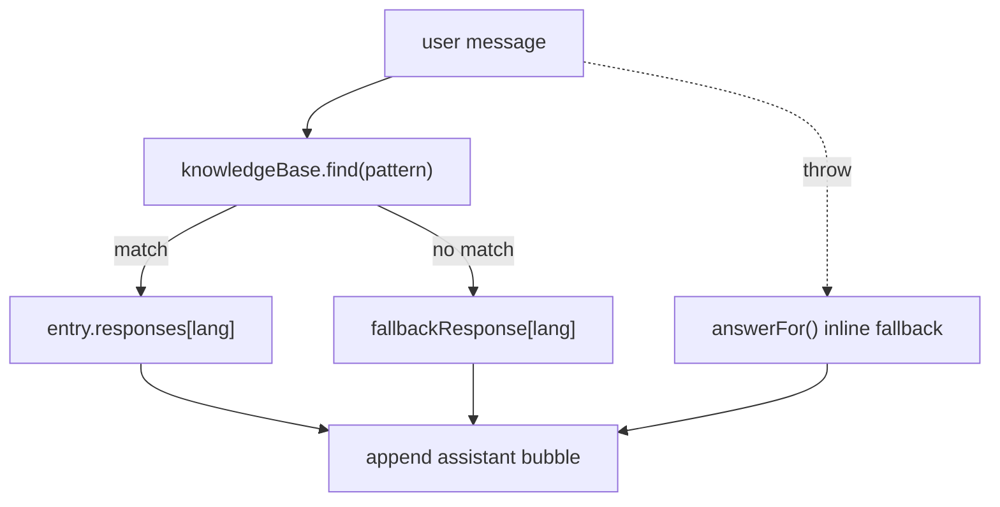
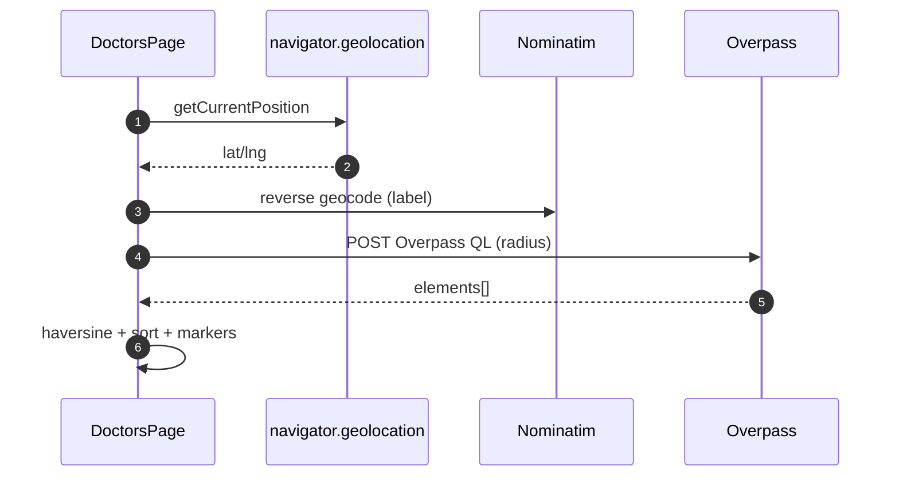

# Brafie · Complete Project Guide

A single, evidence-based reference for the whole codebase: what it is, how every
feature actually runs, where data goes, what is real versus mocked, and how to
learn the system from zero.

> **Source of truth.** Everything here was read from the code at commit
> `502df30` (`content: lead English stats with GLOBOCAN Africa figure`). Where a
> claim comes from a specific file it is cited as `path:line`. If code and this
> document ever disagree, the code wins: re-read the cited file.
>
> **Scope.** This document is descriptive. It does not change application code,
> content, or contracts. Read-only companion: `docs/GHANA_LOCALISATION.md`
> (what was localised and what is still unverified) and `docs/ASSETS.md`
> (image/asset plan).

---

## Table of contents

1. [Executive summary](#1-executive-summary)
2. [System architecture](#2-system-architecture)
3. [Project map](#3-project-map)
4. [Runtime boot and routing](#4-runtime-boot-and-routing)
5. [Feature execution traces](#5-feature-execution-traces)
6. [Frontend deep-dive](#6-frontend-deep-dive)
7. [Backend deep-dive](#7-backend-deep-dive)
8. [Data flows and persistence inventory](#8-data-flows-and-persistence-inventory)
9. [Chatbot and speech deep-dive](#9-chatbot-and-speech-deep-dive)
10. [Diagram gallery](#10-diagram-gallery)
11. [Development and deployment workflow](#11-development-and-deployment-workflow)
12. [Limitations, risks and known gaps](#12-limitations-risks-and-known-gaps)
13. [Learning roadmap](#13-learning-roadmap)
14. [Glossary and appendix](#14-glossary-and-appendix)

---

## 1. Executive summary

**Brafie** is an English-first breast-health **awareness and self-check**
Progressive Web App adapted for Ghana from the open-source **Sahtek** project.
It is a **single-page React application** with no server-side rendering and, in
its shipped configuration, **no live backend dependency**.

What that means in practice, in one paragraph: a woman opens the app, reads
plain-English education, walks through a timed 5-step self-check, optionally
answers a 10-question awareness questionnaire scored locally, can chat with a
**local knowledge-base assistant** (no LLM, no network), can speak to it using
the browser's speech recognition, can find nearby medical facilities on a live
OpenStreetMap map, and can set a monthly reminder. Her answers, chat history and
progress stay in `localStorage` on her device.

### The single most important architectural fact

There are **two codebases**:

- `src/` · the **React frontend** that users actually run.
- `backend/` · a **.NET 8 API** (`SahtekApi`) that exists in the repo but is
  **not called by any active frontend path**. Its only live consumers
  (`src/services/contentService.ts`, `src/services/chatService.ts` via
  `src/hooks/useChat.ts`) are dead code.

So the README's "AI chatbot powered by Groq / Llama 3.3 70B" and "AI risk
analysis" describe an earlier architecture. In the shipped build the chatbot is
local (`src/services/aiChat.ts`) and risk scoring is local
(`src/services/riskService.ts`). This is documented as an intentional privacy
hardening in `src/services/aiChat.ts:4-22`.

### At a glance

| Dimension | Reality |
|---|---|
| App type | Client-rendered SPA + PWA |
| Language shipped | English only (`SUPPORTED_LANGUAGES = ['en']`) |
| Rendering | React 18 `createRoot`, `BrowserRouter`, `StrictMode` |
| State | Zustand stores + `localStorage`; no server state |
| Network at runtime | OSM/Overpass/Nominatim (Doctors map); everything else offline |
| LLM | None in active paths (local knowledge base) |
| Backend | .NET 8 API present, unused by active UI |
| Data leaving device | Map search text/location; speech audio to the browser vendor's speech service (with consent) |
| Analytics / accounts | None |

---

## 2. System architecture

### 2.1 Layered view



The dotted edge is the key: `contentService`/`chatService` can reach the backend,
but nothing mounted in the app imports them (see [§7](#7-backend-deep-dive) and
[§12](#12-limitations-risks-and-known-gaps)).

### 2.2 Runtime request flow (happy path)



---

## 3. Project map

```
breast-cancer-project/
├── index.html                  SPA shell (single <div id="root">)
├── package.json                name "sahtek"; scripts dev/build/preview/lint/format/seo
├── vite.config.ts              React + VitePWA (autoUpdate), "@" -> ./src alias
├── tailwind.config.js          design tokens -> utility classes
├── tsconfig.json               strict-ish; noUnusedLocals/Parameters = false
├── .eslintrc.cjs               Vite React-TS baseline
├── backend/                    .NET 8 API (see §7) · UNUSED by active UI
├── scripts/
│   ├── generate-seo.mjs        post-build per-route HTML + sitemap + robots
│   ├── generate-assets.mjs     brand SVGs + OG cards (per docs/ASSETS.md)
│   └── optimize-images.mjs     AVIF/WebP pipeline (per docs/ASSETS.md)
├── docs/
│   ├── GHANA_LOCALISATION.md   localisation decisions + unverified items
│   ├── ASSETS.md               image plan
│   └── architecture/
│       └── BRAFIE_COMPLETE_PROJECT_GUIDE.md   ← this file
├── public/
│   ├── assets/                 step-*.svg, sign-*.svg, how-*.svg, body-map-*, screens/
│   └── og/                     brafie-og.png, signs-og.png, ...
├── screenshots/                placeholder captures (see README)
└── src/
    ├── main.tsx                entry: createRoot + StrictMode + BrowserRouter
    ├── App.tsx                 route table + MotionConfig + reminder resume
    ├── config/                 api.ts (API URL, USE_MOCK), constants.ts (identity, keys)
    ├── components/
    │   ├── layout/             Layout, Navbar, BottomNav, Footer, PageTransition, NavArrows, MobileDrawer
    │   ├── ui/                 25 presentational primitives (Button, Modal, SafetyNote, ...)
    │   ├── home/               marketing sections (Hero children, PreviewScreen, ...)
    │   ├── learn/              BodyMap, PreventionTracker, MythsWall
    │   ├── reminder/           GlassCalendar
    │   └── motion/             Reveal / RevealGroup / RevealItem
    ├── data/                   en copy mirrors + static data (content, riskQuestions, riskCopy, signs, chatKnowledge)
    ├── hooks/                  useLanguage, useSelfCheck, useRiskAssessment, useSpeech, useSpeechRecognition, useTheme, usePersistedState, useDocumentMeta, useParallax, useChat(dead), useMediaQuery(dead)
    ├── i18n/                   index.ts (loader) + en.ts (frozen shape) + 6 dormant locales
    ├── pages/                  13 routed screens + DesignSystemPage (unlisted)
    ├── seo/                    routes.ts (registry) + schema.ts (JSON-LD)
    ├── services/               aiChat, api(axios), chatService(dead), contentService(dead), mockService, riskService, whatsappService(disabled)
    ├── stores/                 languageStore, userStore, chatStore
    ├── styles/                 tokens.css + global css
    ├── types/                  api.ts, chat.ts, risk.ts
    └── utils/                  formatters, calendarReminder, reportGenerator, notificationScheduler, cn
```

---

## 4. Runtime boot and routing

### 4.1 Boot sequence

`src/main.tsx` (13 lines) is the only mount point:

1. `createRoot(document.getElementById('root'))`.
2. Wrap in `<StrictMode>` (double-invokes effects in dev; harmless here).
3. Wrap in `<BrowserRouter>` (HTML5 history routing).
4. Render `<App />`.

`src/App.tsx` then:

1. Calls `useTheme()` (`src/App.tsx:40`), the sole owner of the `.dark` class
   on `<html>`.
2. Runs a mount effect (`src/App.tsx:43-53`) that reads the saved reminder from
   `localStorage[REMINDER_STORAGE_KEY]` and, if `isActive`, calls
   `scheduleNotificationCheck(...)` so an already-open tab can still fire it.
3. Renders `<MotionConfig reducedMotion="user">` (`src/App.tsx:63`) so framer
   drops transforms app-wide when the OS requests reduced motion.
4. Renders `<Routes>` inside `<AnimatePresence mode="wait">`.

### 4.2 Route table

From `src/App.tsx:65-99`. All routes except `/design-system` render inside
`<Layout />`.

| Path | Element | Lazy | In global page order? |
|---|---|---|---|
| `/` | `HomePage` | no | yes (1) |
| `/signs` | `SignsPage` | no | yes (2) |
| `/when-to-seek-help` | `WhenToSeekHelpPage` | no | no |
| `/faq` | `FaqPage` | no | no |
| `/about` | `AboutPage` | no | no |
| `/learn` | `LearnPage` | no | yes (3) |
| `/self-check` | `SelfCheckPage` | no | yes (4) |
| `/risk-factors` | `RiskFactorsPage` | no | no |
| `/risk` | `RiskAssessmentPage` | no | yes (5) |
| `/companion` | `CompanionPage` | no | no |
| `/chat` | `ChatPage` | no | yes (6) |
| `/doctors` | `DoctorsPage` | **yes** | yes (7) |
| `/reminder` | `ReminderPage` | no | yes (8) |
| `/home` | `Navigate to "/"` | no | no |
| `*` | `NotFoundPage` | no | no |
| `/design-system` | `DesignSystemPage` | **yes** | outside Layout, unlisted |

Two routes are lazy because they pull heavy dependencies:
`DoctorsPage` (MapLibre GL) and `DesignSystemPage` (dev-only preview).
`RouteFallback` (`src/App.tsx:27`) is the spinner shown during the lazy chunk.

### 4.3 The Layout shell

`src/components/layout/Layout.tsx` is the persistent chrome around `<Outlet />`:

- Owns SEO via `useDocumentMeta()` and URL-language sync via
  `useLanguageFromUrl()` (`Layout.tsx:29-30`).
- Scrolls to top on path change (`Layout.tsx:32-34`).
- Defines a **global sequential page order** (`Layout.tsx:38-47`) and renders
  corner `NavArrows` for known pages, except `/learn` which owns its own
  tab-aware arrows (`Layout.tsx:59`).
- Renders a **global Stop-audio button** whenever any narration is playing
  (`Layout.tsx:84-94`), because `useSpeech` keeps audio playing across
  navigation.
- Mounts `ToastViewport` (`Layout.tsx:74`); before this was mounted, every
  `toast()` call went nowhere.
- Uses `overflow-x-clip` deliberately, not `overflow-x-hidden`, so `sticky`
  on the Navbar keeps working (`Layout.tsx:62-65`).

### 4.4 Navigation surfaces

- `Navbar` (`src/components/layout/Navbar.tsx`, 128 lines): sticky glass bar,
  logo, desktop primary links, theme toggle, mobile drawer.
- `BottomNav` (42 lines): fixed 4-tab mobile bar (Home / Learn / Chat /
  Self-check).
- `Footer` (165 lines): brand + explore links + legal/social (only rendered when
  configured in `constants.ts`) + full `Disclaimer`.
- `NavArrows` (80 lines): prev/next corner pills, RTL-aware.
- `MobileDrawer` (176 lines): portal drawer with focus trap and Escape close.

---

## 5. Feature execution traces

Each trace lists the exact files and functions involved, in order.

### 5.1 Application start and first paint

1. `index.html` loads the JS bundle and calls `src/main.tsx`.
2. `main.tsx` mounts `App` inside `StrictMode` + `BrowserRouter`.
3. `App` runs `useTheme()` and the reminder-resume effect.
4. `Layout` calls `useLanguage()` -> `useTranslation(lang)`
   (`src/i18n/index.ts:46`), which returns the eager English object (`en`) or
   falls back to `en` (`i18n/index.ts:52`).
5. `useDocumentMeta()` writes `<title>`, description, canonical, hreflang, OG,
   Twitter and JSON-LD (`src/hooks/useDocumentMeta.ts:64-129`).
6. Route element renders; `PageTransition` animates it in.

### 5.2 Home (`/`)

`src/pages/HomePage.tsx` (222 lines). A composition of `src/components/home/*`
sections: hero with scroll parallax (`useParallax`, `HomePage.tsx:63`), a trust
bar, a 6-card "what Brafie helps you do" grid, then `TwelveSigns`, `HowItWorks`,
`SelfCheckPreview`, `Companion`, `RiskFactors`, `NextSteps`, `Credibility`,
`Faq`, `FinalCta`. Uses only the `t.home` namespace. CTAs route to
`/self-check` and `/learn`.

### 5.3 Learn (`/learn`)

`src/pages/LearnPage.tsx` (180 lines). Tabbed hub derived from
`Object.entries(t.learn.tabs)` (`LearnPage.tsx:18`). The active tab is persisted
under `sahtek_learn` via `usePersistedState` (`LearnPage.tsx:19`), with a
stale-key guard effect (`:22-24`). Renders `BodyMap`, `PreventionTracker` and
`MythsWall` per tab. Uses a hybrid `NavArrows` that steps tabs and spills to `/`
(first prev) and `/self-check` (last next).

### 5.4 The 12 Signs (`/signs`)

`src/pages/SignsPage.tsx` (249 lines). Anchor-per-sign education page
(`#sign-N` via `signAnchor()`), staggered reveal, alternating image side, a
per-sign copy-link button, and a Web Share API `share()` callback with clipboard
fallback (`SignsPage.tsx:41-68`). Icons come from `src/data/signs.ts`
(`SIGN_ICONS`). Copy is `t.signsPage` + reused `t.home.signs` /
`t.home.nextSteps`.

### 5.5 Guided self-check (`/self-check`)

This is the richest client-side state machine.

`src/pages/SelfCheckPage.tsx` (379 lines):

1. Builds a memoised `guide: SelfCheckStep[]` by merging language-independent
   `STEP_META` (`SelfCheckPage.tsx:37-43`) with translated words from
   `t.selfCheck.steps` (`:62-77`). Memoisation matters: an unstable array makes
   the timer reset every render and the countdown freezes.
2. Uses `useSelfCheck(guide)` for the wizard and per-step countdown.
3. Uses `useSpeech()` to narrate the current step's instruction, gated on
   `canNarrate = voicesLoaded && hasVoice(lang)` (`:92`).
4. Three stages: `intro`, `active`, `done`, each a distinct layout.
5. On `done`, reveals a reminder nudge after a 2s delay (`:96-105`) and routes
   the user into the same four-lane decision logic the homepage teaches, from
   `t.home.nextSteps.cards`.

`src/hooks/useSelfCheck.ts` (208 lines) is the engine:

- Storage key `sahtek_selfcheck`, max age 24h (`useSelfCheck.ts:6-7`).
- Reads a fresh snapshot once on mount and seeds all state (`:58-66`), so
  leaving and returning resumes the exact step and countdown.
- Persists on every change except the untouched `intro` stage (`:96-113`).
- Countdown ticks via one `setInterval` per run/pause cycle, using a functional
  updater (`:118-124`).
- **Auto-advance** fires only on a true `>0 -> 0` transition, tracked with a
  `prevRemaining` ref, so it never fires on the reset that re-arms each step
  (`:176-182`).
- `restart()` clears the snapshot (`:155-161`).

`SelfCheckStep` type: `src/types/api.ts:55-63`.



### 5.6 Risk assessment (`/risk`)

`src/pages/RiskAssessmentPage.tsx` (221 lines) drives
`src/hooks/useRiskAssessment.ts` (138 lines).

Flow: `intro -> quiz -> analyzing -> result`.

- Questions from `getRiskQuestions(lang)` (`src/data/riskQuestions.ts:118`), 10
  questions with per-option weights; `MAX_RISK_SCORE` is derived from the META
  table (`riskQuestions.ts:23`).
- Snapshot persisted under `sahtek_risk` via a `{value, _timestamp}` envelope
  (`useRiskAssessment.ts:52`); `analyzing` is transient and not persisted.
- On the last answer, `submit()` calls `assessRisk(...)`, which calls
  `mockRiskAssessment(...)` (`src/services/riskService.ts:10-12` ->
  `src/services/mockService.ts:68`).

The scoring algorithm (`mockService.ts:68-125`):

1. Sum `option.weight` for each answered question.
2. `percentage = round(score / MAX_RISK_SCORE * 100)`.
3. `levelFromPercentage`: `<33 low`, `<66 moderate`, else `high`
   (`mockService.ts:62-66`).
4. Build recommendations from `RECOMMENDATIONS` + factor logic, sorted
   high-priority first (`:93-111`).
5. Attach `RISK_SUMMARY`, `RISK_NEXT_STEPS`, `RISK_DISCLAIMER` from
   `src/data/riskCopy.ts`, all language-keyed.

The result screen (`RiskAssessmentPage.tsx:135-218`) is careful about framing:
the number is labelled an **awareness score**, not a probability
(`:143-148`), carries `t.risk.notAProbability`, and offers copy-to-clipboard,
lazy-imported `downloadPDF`, `downloadJSON` and retake.

> The page comment (`RiskAssessmentPage.tsx:41-45`) records that this screen
> **used to** POST the raw questionnaire to a third-party LLM on render. That
> path is gone; scoring is local.

### 5.7 Chat (`/chat`) and voice input

`src/pages/ChatPage.tsx` (275 lines).

- Message history persisted under `sahtek_chat` (max age 7 days,
  `ChatPage.tsx:84-92`); draft persisted under `sahtek_chat_draft` (`:95`).
- Capped at `MAX_MESSAGES = 50` (`:83`, `:156`).
- `send()` calls `askChat(trimmed, lang)` (`:162`), which matches the local
  `knowledgeBase` regexes (`src/services/aiChat.ts:31-34`). On throw it falls
  back to the inline `answerFor()` (`ChatPage.tsx:51-81`, `:165`).
- Voice input uses `useSpeechRecognition({ lang, onResult })`
  (`src/hooks/useSpeechRecognition.ts`). The mic is gated by a one-time consent
  modal; consent is remembered under `sahtek:mic-consent` (`ChatPage.tsx:21`,
  `:118`, `:138-149`). Speech only fills the input; the user still presses Send.
- Quick replies come from `t.chat.quickReplies`.

### 5.8 Reminders (`/reminder`)

`src/pages/ReminderPage.tsx` (828 lines), a three-step wizard (day -> time ->
method) plus a confirmed view.

- Settings persisted under `REMINDER_STORAGE_KEY = 'sahtek.reminder'`
  (`src/utils/notificationScheduler.ts:8`). `loadSettings()` migrates older
  `notificationMethods`/`phone` keys and **drops** `email`/`whatsapp` from saved
  settings (`ReminderPage.tsx:208-232`).
- Methods offered: **calendar** (`.ics` download via
  `src/utils/calendarReminder.ts`, the only method that fires when the app is
  closed) and **push** (in-page `Notification` only).
- **Email** is rendered disabled ("Coming soon"); **WhatsApp** is disabled
  because `checkWhatsAppAvailable()` always resolves `false`
  (`src/services/whatsappService.ts`).
- Push: `scheduleNotificationCheck()` (`notificationScheduler.ts:36-62`) polls
  once a minute and fires within the first five minutes of the target hour, once
  per day. It is explicitly **not** background push
  (`notificationScheduler.ts:28-35`).

### 5.9 Doctors map (`/doctors`, lazy)

`src/pages/DoctorsPage.tsx` (748 lines), the only page making live network calls.

1. Initialises a MapLibre map with a CARTO voyager style
   (`DoctorsPage.tsx:280-291`).
2. Auto-detects location on mount (`:337-340`) via `navigator.geolocation`.
3. `searchMedicalFacilities()` POSTs an Overpass QL query for hospitals,
   clinics, doctors, pharmacies and labs within a radius (`:141-203`).
4. Reverse-geocodes the fix with Nominatim for a street-level label (`:306-320`).
5. City search + debounced autocomplete via Nominatim (`:350-416`), biased to
   the user's area but not bounded.
6. Distances computed with a local `haversineDistance()` (`:205-211`).
7. Filters, radius buttons, marker popups, and a distance-sorted card list
   (capped at 20, `:681`).
8. Shows an unvetted-data `SafetyNote` above results (`:500-505`) and a
   `Disclaimer` at the bottom.

> The page's own per-language `T` map (`DoctorsPage.tsx:38-121`) is one of the
> dormant local maps noted in `docs/GHANA_LOCALISATION.md`; only `en` is
> reachable.

### 5.10 Report export

`src/utils/reportGenerator.ts` (201 lines). `RiskAssessmentPage` lazy-imports
`downloadPDF` / `downloadJSON` (`RiskAssessmentPage.tsx:196, 207`), so jsPDF
only ships when a report is actually downloaded. Note: jsPDF's Latin fonts
cannot render Arabic/Russian glyphs; JSON export always works.

### 5.11 Internationalisation (i18n)

- `src/i18n/index.ts` loads **English eagerly** and exposes `useTranslation`.
  A lazy `LAZY` map exists but is empty; adding a locale means a new
  `<code>.ts` file implementing `Translation`, one line in `LAZY`, and an entry
  in `SUPPORTED_LANGUAGES` (`i18n/index.ts:7-22`).
- `src/i18n/en.ts` defines `Translation` as `typeof en` (`en.ts:931`).
  **Its shape is frozen**: the six dormant locales are typed `: Translation`, so
  changing a key breaks type-checking for all of them.
- `useLanguage()` clamps a legacy persisted language (e.g. `ar`) to English
  (`src/hooks/useLanguage.ts:21-24`) so a stale preference can never flip the
  UI into RTL.
- `useLanguageFromUrl()` / `useSetLanguage()` (`useDocumentMeta.ts:151-199`)
  make `?lang=` a real, shareable URL for hreflang, with a strictly one-way
  URL -> store sync (the comment at `:140-149` explains the back-button bug the
  bidirectional version caused).
- `LanguageSwitch` renders nothing while fewer than two languages are supported
  (`src/components/ui/LanguageSwitch.tsx:63`).

### 5.12 Error handling

- **API layer**: `src/services/api.ts:16-24` installs a response interceptor
  that `console.warn`s and re-rejects. No retry, no UI surfacing.
- **Chat**: try/catch around `askChat` with an inline fallback
  (`ChatPage.tsx:160-169`).
- **Risk**: no catch around `assessRisk`; the mock cannot reject in practice.
- **Storage**: every direct `localStorage` access is wrapped in try/catch
  (`useSelfCheck`, `useRiskAssessment`, `usePersistedState`,
  `notificationScheduler`, `ReminderPage`).
- **Map**: Overpass/Nominatim failures set empty results or a location error;
  reverse-geocode failure is best-effort (`DoctorsPage.tsx:318-320`).
- **Backend** (if ever called): global `UseExceptionHandler` returns a
  JSON `ErrorResponse` (`backend/Program.cs:50-66`).

---

## 6. Frontend deep-dive

### 6.1 Stack

| Concern | Choice | Version |
|---|---|---|
| UI | React | 18.3.1 |
| Build/dev | Vite | 5.4.8 |
| Language | TypeScript | 5.6.2 |
| Styling | Tailwind CSS | 3.4.13 |
| Animation | framer-motion | 11.5.6 |
| State | Zustand | 4.5.5 |
| Routing | react-router-dom | 6.26.2 |
| HTTP | axios | 1.7.7 |
| PDF | jspdf | 4.2.1 |
| Maps | maplibre-gl | 5.24.0 |
| Icons | lucide-react | 0.445.0 |
| PWA | vite-plugin-pwa | 0.20.5 |

Path alias: `@` -> `./src` (`vite.config.ts:41-45`).

### 6.2 State management

Three Zustand stores, all persisted to `localStorage`:

| Store | Key | Shape | Notes |
|---|---|---|---|
| `languageStore.ts` | `sahtek:lang` | `{ lang, setLang }` | default `en` |
| `userStore.ts` | `sahtek:user` (derived from `STORAGE_KEYS.onboarded`) | `theme`, `onboarded`, `preventionChecklist`, `selfCheckLog`, `reminder` | `version: 1` with a migrate that forces old `light` -> `system` |
| `chatStore.ts` | `sahtek:chat` | `messages[]` + actions | custom `merge` drops stale `pending` bubbles |

There is also a non-persisted toast store (`src/components/ui/toastStore.ts`).

Local component state (not Zustand) backs the self-check, risk quiz, learn tabs
and chat, via `usePersistedState` or bespoke snapshot logic.

### 6.3 Hook inventory

| Hook | Purpose | Live? |
|---|---|---|
| `useLanguage` | translation + dir + font class; clamps unsupported lang | yes |
| `useTheme` | sole owner of `.dark`; bridges store + OS preference | yes |
| `useSelfCheck` | self-check wizard + timer + persistence | yes |
| `useRiskAssessment` | risk quiz state machine + persistence | yes |
| `useSpeech` | module-level `SpeechSynthesis` state, survives unmount | yes |
| `useSpeechRecognition` | Web Speech recognition wrapper | yes |
| `usePersistedState` | `useState` backed by `{value,_timestamp}` in localStorage | yes |
| `useDocumentMeta` | `<head>` for route + language; `useLanguageFromUrl`/`useSetLanguage` | yes |
| `useParallax` | light scroll parallax, reduced-motion safe | yes |
| `useChat` | backend chat engine via `sendChatMessage` | **dead** |
| `useMediaQuery` | `useMediaQuery`/`useIsDesktop`/`usePrefersReducedMotion` | **dead** |

### 6.4 Styling and design system

- Tokens live in `src/styles/tokens.css`, surfaced through
  `tailwind.config.js`. `DesignSystemPage` (`/design-system`, 600 lines) is a
  live preview that reads computed CSS variables and renders WCAG contrast
  badges; it is unlisted and disallowed in `robots.txt`.
- `src/utils/cn.ts` merges classes with tailwind-merge, extended with a custom
  `font-size` group to avoid size-vs-colour collisions.
- Reduced motion is handled centrally by `MotionConfig reducedMotion="user"`
  (`App.tsx:63`), with CSS `motion-safe:` and a media query for keyframes, and
  self-guarding in `useParallax` and `Confetti`.

### 6.5 Accessibility patterns

- Focus-trapped, Escape-closable `Modal` and `MobileDrawer`.
- `SafetyNote` renders `role="note"`; `Progress` requires a `label` so screen
  readers hear the sentence, not "progress bar 20%".
- Decorative art is `aria-hidden`; meaningful images take translated `alt` from
  i18n (`docs/ASSETS.md:67-70`).
- `axe-core` is a dev dependency (available for audit; no test runner wired).

---

## 7. Backend deep-dive

`backend/` is a standalone **.NET 8** web API, `SahtekApi`
(`backend/SahtekApi.csproj`, `net8.0`). Its only NuGet dependency is
`Swashbuckle.AspNetCore 6.6.2` (Swagger). There is **no database, no EF Core,
no authentication, and no persistence**.

### 7.1 Composition (`backend/Program.cs`)

1. Controllers with `PropertyNamingPolicy = null` (PascalCase preserved) and
   null-skipping JSON (`Program.cs:9-14`).
2. A custom invalid-model response producing the `ErrorResponse` envelope
   (`:16-32`).
3. Swagger in development (`:34-35`, `:70-74`).
4. CORS policy **`"AllowAll"`**: any origin, any method, any header
   (`:37-43`, `:68`).
5. DI: `IRiskCalculatorService -> RiskCalculatorService` (scoped) and
   `IGeminiService -> GeminiService` (typed `HttpClient`) (`:45-46`).
6. Global exception handler returning JSON (`:50-66`).
7. `app.MapControllers()` (`:76`).

### 7.2 Endpoint inventory

| Method | Route | Controller | Behavior |
|---|---|---|---|
| GET | `/api/v1/health` | `HealthController` | health payload |
| POST | `/api/v1/chat` | `ChatController` | forwards to `IGeminiService` |
| GET | `/api/v1/content/{topic}` | `ContentController` | **hardcoded Arabic** sample content |
| GET | `/api/v1/self-check-guide?language=ar` | `SelfCheckGuideController` | default language `ar` |
| GET | `/api/v1/statistics` | `StatisticsController` | **hardcoded** `global` + `morocco` figures |
| POST | `/api/v1/reminders` | `RemindersController` | reminder acknowledgement |
| POST | `/api/v1/risk-assessment` | `RiskAssessmentController` | `RiskCalculatorService.Calculate(...)` |

### 7.3 The two services

- `RiskCalculatorService` (`backend/Services/RiskCalculatorService.cs`, 179
  lines): a server-side scoring implementation with `MaxScore = 12`, thresholds
  `<5 low / <10 moderate / else high`, and Arabic/French/English copy.
  **It is not the algorithm the frontend uses**; the frontend has its own
  (`src/data/riskQuestions.ts` + `mockService.ts`). The two are independent and
  can disagree.
- `GeminiService` (`backend/Services/GeminiService.cs`, 110 lines): despite the
  name, it calls the **DeepSeek** API (`api.deepseek.com`, model
  `deepseek-chat`, `GeminiService.cs:16-17`) and reads the key from the
  `DEEPSEEK_API_KEY` environment variable (`:25`). Its system prompt is still
  Morocco/Darija-flavoured (`:19`). `backend/render.yaml` declares
  `DEEPSEEK_API_KEY` as a synced (secret) env var.

### 7.4 Deployment

`backend/Dockerfile` + `backend/render.yaml` (Render web service named
`sahtek-api`, docker runtime). The frontend's `API_URL` default points at
`https://sahtek-tech.onrender.com/api/v1` (`src/config/api.ts:5`), but nothing
active calls it.

> **Key finding.** The frontend does not use the backend. `USE_MOCK` is `false`
> (`src/config/api.ts:9`), but the only consumers of the live API
> (`src/services/chatService.ts`, `src/services/contentService.ts`) are imported
> by nothing mounted. The single `USE_MOCK` read is a demo-note in
> `ReminderPage.tsx:626`. See [§12](#12-limitations-risks-and-known-gaps).

---

## 8. Data flows and persistence inventory

### 8.1 Where data lives

There is no server-side user data. Everything sensitive is on the device.

| Data | Storage key | Written by | Read by | Lifetime |
|---|---|---|---|---|
| Language | `sahtek:lang` | `languageStore` | `useLanguage` | persistent |
| User prefs/progress | `sahtek:user` | `userStore` | `useTheme` etc. | persistent |
| Chat messages | `sahtek:chat` (store) / `sahtek_chat` (page) | `chatStore`, `ChatPage` | Chat | 7 days (page) |
| Chat draft | `sahtek_chat_draft` | `ChatPage` | Chat | persistent |
| Mic consent | `sahtek:mic-consent` | `ChatPage` | Chat | persistent |
| Learn tab | `sahtek_learn` | `LearnPage` | Learn | persistent |
| Self-check snapshot | `sahtek_selfcheck` | `useSelfCheck` | `useSelfCheck` | 24h |
| Risk snapshot | `sahtek_risk` | `useRiskAssessment` | `useRiskAssessment` | persistent |
| Reminder settings | `sahtek.reminder` | `ReminderPage` | `App`, scheduler | persistent |
| Last-notified date | `sahtek.reminder.lastNotified` | scheduler | scheduler | persistent |

### 8.2 Data-flow diagram



### 8.3 Storage-key inconsistencies (flagged, not fixed)

The codebase mixes two key conventions, and a few keys are declared but unused:

- **Colon vs underscore**: stores use `sahtek:...` (`STORAGE_KEYS`), while
  `ChatPage` (`sahtek_chat`), `LearnPage` (`sahtek_learn`), `useSelfCheck`
  (`sahtek_selfcheck`) and `useRiskAssessment` (`sahtek_risk`) use underscores.
- **Dot vs colon**: `REMINDER_STORAGE_KEY = 'sahtek.reminder'`
  (`notificationScheduler.ts:8`) differs from `STORAGE_KEYS.reminder =
  'sahtek:reminder'` (`constants.ts:34`). The reminder feature uses the dot form.
- **Declared but unused**: `STORAGE_KEYS.theme`, `.preventionChecklist`,
  `.selfCheckLog`, `.reminder` are not read anywhere; `userStore` derives
  `sahtek:user` and manages theme/progress itself.
- **Duplicate chat keys**: `chatStore` persists `sahtek:chat`, but `ChatPage`
  persists its own `sahtek_chat`. The two are unrelated despite both being
  "chat".

These are inert today (each writer/reader pair is self-consistent) but are a
footgun for future work. Recorded here rather than silently changed.

---

## 9. Chatbot and speech deep-dive

### 9.1 The chat "brain" is local

`src/services/aiChat.ts` (34 lines) is the entire brain:

```ts
const entry = knowledgeBase.find((e) => e.pattern.test(message));
return entry ? entry.responses[lang] : fallbackResponse[lang];
```

- `knowledgeBase` is an array of `KnowledgeEntry`
  (`src/data/chatKnowledge.ts:10-17`): a `RegExp` pattern plus a
  `Record<Language, string>` of responses. There are ~11 entries (symptoms,
  self-check, mammography, treatment, prevention, fear, myths, diet, exercise,
  genetics, age, greeting, thanks).
- If nothing matches, `fallbackResponse[lang]` is returned.
- The header comment (`aiChat.ts:4-22`) explains the deliberate removal of the
  old browser-side Groq call, and instructs future AI work to route through
  `POST /api/v1/chat` with explicit consent.

`ChatPage` also has an inline `answerFor()` (`ChatPage.tsx:51-81`) used only as
a catch fallback; it duplicates a little of the knowledge base.

### 9.2 Why this matters

- No message, no conversation history, and no derived context block ever leaves
  the device on the text path.
- The assistant cannot diagnose and is framed as educational; the disclaimer is
  pinned to the page rather than only seeded as the first bubble
  (`ChatPage.tsx:254-258`).

### 9.3 Speech output (`useSpeech`)

`src/hooks/useSpeech.ts` (137 lines):

- State lives at **module scope** (`globalIsSpeaking`, `globalActiveId`) with a
  listener set (`useSpeech.ts:34-40`), so narration keeps playing after the
  starting component unmounts, and every mounted consumer stays in sync.
- `LANG_VOICE_MAP` maps each language to preferred BCP-47 voice codes,
  matched on the primary subtag (`:6-26`).
- `speak(text, lang, id)` toggles (clicking the same card stops it), cancels
  prior speech, sets `rate 0.85` / `pitch 1.1`, and picks the best installed
  voice (`:72-116`).
- No unmount cleanup cancels speech, by design; the global Stop button in
  `Layout` is the control (`:126-127`).

### 9.4 Speech input (`useSpeechRecognition`)

`src/hooks/useSpeechRecognition.ts` (117 lines): a Web Speech API wrapper
returning `{ supported, listening, start, stop }`, with a per-language BCP-47
map and a single reused recognizer that aborts on unmount. Used only in
`ChatPage`.

### 9.5 Privacy boundary for voice

Voice **input** is the one chat path that leaves the device: the browser ships
audio to its speech vendor (e.g. Google) to transcribe. This is disclosed once
in plain language and gated behind consent (`ChatPage.tsx:16-21`, `:136-149`).
Voice **output** (`SpeechSynthesis`) is on-device.

---

## 10. Diagram gallery

### 10.1 Component tree (routed app)



### 10.2 Self-check state machine

(see [§5.5](#55-guided-self-check-self-check) for the full diagram)

### 10.3 Risk scoring pipeline



### 10.4 Chat decision flow



### 10.5 Doctors request sequence



---

## 11. Development and deployment workflow

### 11.1 Prerequisites

- Node.js >= 18 (developed on Node 24), npm >= 9.
- No API key is required: the shipped app needs none.

### 11.2 Commands (`package.json:7-14`)

```bash
npm install          # install dependencies
npm run dev          # Vite dev server on :5173 (host: true)
npm run build        # tsc -b && vite build && node scripts/generate-seo.mjs
npm run preview      # serve the production build locally
npm run lint         # eslint, --max-warnings 0
npm run format       # prettier on src/**/*.{ts,tsx,css}
npm run seo          # regenerate SEO shells only
```

### 11.3 Environment variables

| Variable | Used by | Default | Purpose |
|---|---|---|---|
| `VITE_API_URL` | `src/config/api.ts` | `https://sahtek-tech.onrender.com/api/v1` | backend base URL (unused by active UI) |
| `VITE_SITE_ORIGIN` | `src/hooks/useDocumentMeta.ts` | `https://sahtek.tech` | canonical/OG/JSON-LD origin at runtime |
| `SITE_ORIGIN` | `scripts/generate-seo.mjs` | `https://sahtek.tech` | same origin at build time |
| `VITE_USE_MOCK` | declared in `vite-env.d.ts` | n/a | legacy flag |

> Note the naming split: the runtime hook reads `VITE_SITE_ORIGIN`, the build
> script reads `SITE_ORIGIN`. Set both to the real domain before launch.

### 11.4 Build pipeline

1. `tsc -b` type-checks the project (project references).
2. `vite build` bundles the SPA and, via `vite-plugin-pwa`, emits the service
   worker + precache manifest (`vite.config.ts:10-39`).
3. `scripts/generate-seo.mjs` reads `dist/index.html`, strips placeholder head
   tags, and writes one real `dist/<route>/index.html` per route (12 routes)
   with route-specific title/description/canonical/hreflang/OG/Twitter/JSON-LD,
   plus `sitemap.xml` and `robots.txt`.

### 11.5 SEO and PWA

- **Two renderings, one source.** `src/seo/routes.ts` is the single route
  registry; `useDocumentMeta` (runtime) and `generate-seo.mjs` (build) both
  derive from it so crawler tags and browser tags cannot drift
  (`useDocumentMeta.ts:50-58`).
- Social crawlers (WhatsApp, Facebook, iMessage, Slack) do not run JS, which is
  why the build emits real per-route HTML.
- hreflang maps `en -> en-GH` (`generate-seo.mjs:35`); `x-default` is emitted.
- `robots.txt` disallows `/design-system`.
- PWA manifest name "Brafie · Breast Health Ghana", `lang: en`, `dir: ltr`
  (`vite.config.ts:14-29`). `registerType: 'autoUpdate'`.

### 11.6 Backend deploy

`backend/Dockerfile` + `backend/render.yaml` (Render, docker runtime, secret
`DEEPSEEK_API_KEY`). Not part of the frontend build.

---

## 12. Limitations, risks and known gaps

Severity is a judgement about user impact. Every row is grounded in the code.

### 12.1 Architectural

| # | Finding | Severity | Evidence | Why it matters | Next step |
|---|---|---|---|---|---|
| A1 | Frontend does not call the backend; `USE_MOCK=false` yet the live-API consumers are dead | High (for maintainers) | `config/api.ts:9`; `chatService.ts`/`contentService.ts` imported only by dead `useChat.ts` | The repo implies a live client/server app; it is actually client-only. Confuses onboarding and the README | Decide: delete the backend, or wire `contentService`/`chatService` in behind consent |
| A2 | README claims "Groq / Llama 3.3 70B" AI chat + risk analysis | High | `README.md:92,115-118`; reality in `aiChat.ts`, `riskService.ts` | Documentation misrepresents the product and its data flows | Update README to describe the local assistant and local scoring |
| A3 | Backend service named `GeminiService` actually calls DeepSeek | Medium | `GeminiService.cs:16-17` | Misleading name; Morocco/Darija system prompt remains | Rename + re-prompt, or retire the service |
| A4 | Two independent risk-scoring implementations (frontend vs backend) | Medium | `mockService.ts:68` vs `RiskCalculatorService.cs:8` | Different `MaxScore` (frontend derives from META; backend hardcodes 12) and thresholds -> divergent results if both ever run | Pick one as canonical; document the contract |
| A5 | Backend controllers return hardcoded Arabic/Morocco content | Medium | `ContentController.cs:7-8`, `StatisticsController.cs:6-7` | If ever surfaced, it contradicts the English Ghana app | Localise or remove before enabling |

### 12.2 Privacy and data

| # | Finding | Severity | Evidence | Why it matters | Next step |
|---|---|---|---|---|---|
| P1 | Voice input sends audio to the browser's speech vendor | Medium (disclosed) | `ChatPage.tsx:16-21` | Consent-gated and explained, but it is the one chat path off-device | Keep the consent gate; consider on-device recognition where available |
| P2 | Doctors map sends search text + coordinates to OSM/Nominatim/Overpass | Low (inherent) | `DoctorsPage.tsx:163-219` | Expected for a map feature; worth stating in a privacy page | Add a privacy page (currently `/privacy` is not built) |
| P3 | WhatsApp reminders are stubbed and fail closed | Low | `whatsappService.ts`; `ReminderPage.tsx:382` | No reminder is silently promised; UI shows it disabled | Add a server-side proxy before enabling |

### 12.3 Content and medical

| # | Finding | Severity | Evidence | Why it matters | Next step |
|---|---|---|---|---|---|
| M1 | No named medical reviewer; `MEDICAL_REVIEW`/`EVIDENCE_SOURCES` empty | High | `constants.ts:79-81`; `docs/ASSETS.md:114-118` | The app correctly claims no review, but a health app without review is a trust/liability gap | Get a credentialled reviewer; then fill the constants |
| M2 | Ghana-specific statistics absent; US/global figures shown | High | `docs/GHANA_LOCALISATION.md:48` | `1 in 8` / `99%` are US-derived and unrepresentative of Ghana | Source verified Ghana/GLOBOCAN figures; the Africa lead figure was added at `502df30` |
| M3 | Non-`en` bundled content still Morocco-flavoured and partly corrupted | Medium | `docs/GHANA_LOCALISATION.md:47`; `src/data/content.ts` non-`en` blocks | Unreachable while English-only, but a trap if a locale is enabled | Localise + review, or delete the dormant blocks |
| M4 | Dormant per-page local language maps (Doctors, Reminder, Risk, chat, utils) | Low | `docs/GHANA_LOCALISATION.md:60-65` | Only `en` reachable; extra surface to keep in sync | Leave as reference, or prune in a dedicated pass |

### 12.4 Code health / dead code

| # | Finding | Severity | Evidence |
|---|---|---|---|
| C1 | `useChat.ts` unused; `chatService.ts` unused | Low | grep: `useChat` defined only in its file |
| C2 | `contentService.ts` unused | Low | no imports |
| C3 | `mockService.ts` content getters unused (`mockGetSymptoms`, `mockGetSelfCheckGuide`, `mockGetStatistics`, `mockCreateReminder`) | Low | only `mockRiskAssessment` used |
| C4 | `content.ts` `overviewFacts`, `preventionItems`, `myths` unused | Low | not imported |
| C5 | `useMediaQuery.ts` unused | Low | no imports |
| C6 | Storage-key inconsistencies and unused `STORAGE_KEYS` entries | Low | see [§8.3](#83-storage-key-inconsistencies-flagged-not-fixed) |
| C7 | `package.json` name/description still "sahtek" / Morocco | Low | `package.json:2,6` |

### 12.5 Operational

| # | Finding | Severity | Evidence |
|---|---|---|---|
| O1 | Backend CORS is `AllowAll` | Medium (if deployed) | `Program.cs:37-43` |
| O2 | Backend has no auth, rate limiting or persistence | Medium (if deployed) | `Program.cs`; controllers |
| O3 | `SITE_ORIGIN` vs `VITE_SITE_ORIGIN` split can leave SEO pointed at the old domain | Medium | `useDocumentMeta.ts:20` vs `generate-seo.mjs:32` |
| O4 | Push reminders are in-page only, not background push | Low (disclosed) | `notificationScheduler.ts:28-35` |
| O5 | No test runner or test files configured | Medium | no test script in `package.json`; `axe-core` present but unused |

---

## 13. Learning roadmap

Five levels, each building on the last. Estimated time is for a developer new to
this stack.

### Level 1 · Run it and see it (0.5 day)

Goal: get the app running and be able to point at any screen.

1. `npm install`, `npm run dev`, open `http://localhost:5173`.
2. Visit every route in [§4.2](#42-route-table). Note which are in the global
   page order.
3. Open DevTools -> Application -> Local Storage. Walk the self-check and risk
   quiz, and watch `sahtek_selfcheck` / `sahtek_risk` update live.
4. Read `src/App.tsx` end to end (103 lines). It is the map.

Checkpoint: explain how `/doctors` is different from every other route (it is
lazy and it makes network calls).

### Level 2 · Trace one feature (1 day)

Goal: follow one feature from UI to data and back.

1. Pick the self-check. Read `SelfCheckPage.tsx` then `useSelfCheck.ts`.
2. Draw the `intro -> active -> done` state machine yourself and compare to
   [§5.5](#55-guided-self-check-self-check).
3. Find the auto-advance bug that the `prevRemaining` ref prevents
   (`useSelfCheck.ts:176-182`).
4. Repeat for the risk quiz (`RiskAssessmentPage` -> `useRiskAssessment` ->
   `riskService` -> `mockService`).

Checkpoint: state where the risk number comes from, in one sentence, and why the
UI calls it an "awareness score".

### Level 3 · Understand the wiring (2 days)

Goal: reason about the whole frontend without reading every file.

1. Learn the state model: [§6.2](#62-state-management). Which data is in
   Zustand versus component state, and why.
2. Learn i18n: [§5.11](#511-internationalisation-i18n). Add a throwaway key to
   `en.ts` and confirm the six dormant locales still type-check (they will not
   if you change a key rather than add an array item).
3. Learn the Layout shell and the two navigation systems (global `NavArrows`
   vs Learn's own).
4. Learn SEO: read `src/seo/routes.ts`, then `useDocumentMeta.ts`, then
   `scripts/generate-seo.mjs`. Confirm the "two renderings, one source" claim.

Checkpoint: explain why social link previews need the build-time HTML even
though Google would see the runtime tags.

### Level 4 · Reason about the backend and boundaries (2 days)

Goal: know exactly what the two codebases do and do not do.

1. Read `backend/Program.cs` and the seven controllers. Map each endpoint in
   [§7.2](#72-endpoint-inventory).
2. Prove to yourself the frontend never calls it: trace imports of
   `contentService` and `chatService`.
3. Read `GeminiService.cs` and note it calls DeepSeek, not Gemini.
4. Compare the two risk algorithms ([§7.3](#73-the-two-services)) and predict
   where they would diverge.
5. Read `src/services/aiChat.ts` and `chatKnowledge.ts`; explain the privacy
   rationale for the local assistant.

Checkpoint: decide, with reasons, whether to delete the backend or wire it in.

### Level 5 · Extend it safely (ongoing)

Goal: make changes without breaking the contracts and rules.

1. Internalise the hard constraints from `CLAUDE.md` and
   `docs/GHANA_LOCALISATION.md`: English-only, frozen `en.ts` shape, no invented
   Ghana data, no medical-review claims, don't rename storage keys or the
   `Statistics.morocco` contract.
2. Before any change run `npm run lint` and `npm run build` (type-check +
   bundle + SEO). Both must pass.
3. Follow the existing patterns: new page = named export + route in `App.tsx`
   (+ SEO registry entry if crawlable); new data = `src/data/*`; new persistent
   state = a store or `usePersistedState` with a documented key.
4. Read the safety components (`SafetyNote`, `Disclaimer`) before touching any
   screen that routes a woman toward care.
5. Tackle a Level-5 task: add a verified Ghana statistic (with a source), add a
   test runner, or retire the dead backend path.

Checkpoint: ship one change with a passing lint+build and a clear commit
message, touching no contract.

### Suggested first contributions (ordered)

1. Fix README AI claims (A2). Low risk, high clarity.
2. Add a test runner + one test for `mockRiskAssessment` (O5).
3. Reconcile `SITE_ORIGIN`/`VITE_SITE_ORIGIN` (O3).
4. Remove dead code (C1-C5) in a single dedicated commit.
5. Wire or delete the backend (A1).

---

## 14. Glossary and appendix

### 14.1 Glossary

| Term | Meaning here |
|---|---|
| **Brafie** | The Ghana-adapted app (display name). |
| **Sahtek** | The original open-source project; still the package name and many identifiers. |
| **SPA** | Single-Page Application; one HTML shell, routing in JS. |
| **PWA** | Progressive Web App; installable + offline via a service worker. |
| **Zustand** | Small React state library used for the three stores. |
| **Overpass** | API for querying OpenStreetMap data (used for facilities). |
| **Nominatim** | OpenStreetMap geocoding/search service. |
| **hreflang** | Link hint telling search engines which language/region a URL targets. |
| **JSON-LD** | Structured data embedded for rich search results. |
| **HARD RULE 1/2/3/4/6** | Content safety rules referenced in comments (no disease probability; disclaimer on scoring pages; no clinical/anatomical imagery; etc.). |
| **Awareness score** | The risk-quiz number, explicitly not a probability of disease. |
| **Snapshot** | A persisted object capturing a feature's in-progress state. |

### 14.2 Key file quick reference

| I want to... | Open |
|---|---|
| Change routes | `src/App.tsx` |
| Change app name / contact / supported languages | `src/config/constants.ts` |
| Change the API URL / mock flag | `src/config/api.ts` |
| Change English copy | `src/i18n/en.ts` (shape frozen) |
| Change the chat answers | `src/data/chatKnowledge.ts` |
| Change risk questions or scoring | `src/data/riskQuestions.ts`, `src/services/mockService.ts` |
| Change risk result copy | `src/data/riskCopy.ts` |
| Change the self-check steps | `src/pages/SelfCheckPage.tsx` (`STEP_META`) + `en.ts` |
| Change reminders | `src/pages/ReminderPage.tsx`, `src/utils/notificationScheduler.ts` |
| Change SEO routes/schema | `src/seo/routes.ts`, `src/seo/schema.ts`, `scripts/generate-seo.mjs` |
| Change design tokens | `src/styles/tokens.css`, `tailwind.config.js` |
| Change the backend | `backend/Program.cs`, `backend/Controllers/*`, `backend/Services/*` |

### 14.3 Verified facts vs open questions

**Verified from source** (cited throughout): route table, storage keys and
lifetimes, scoring algorithm and thresholds, chat being local, speech behaviour,
backend endpoints and its DeepSeek dependency, SEO/PWA build pipeline, dead-code
inventory, storage-key inconsistencies.

**Open questions to resolve with the maintainer**

1. Should the backend be deleted or wired in behind consent? (A1)
2. Is there a verified Ghana/GLOBOCAN statistic set to replace the US figures?
   (M2)
3. Is there a named clinician who will review the content? (M1)
4. What is the real production domain for `SITE_ORIGIN` / `VITE_SITE_ORIGIN`?
   (O3)
5. Should the dormant non-`en` content and per-page language maps be pruned or
   kept as reference? (M3, M4)

### 14.4 Related documents

- `README.md` · user-facing overview (note the outdated AI claims, A2).
- `docs/GHANA_LOCALISATION.md` · localisation decisions and unverified items.
- `docs/ASSETS.md` · image/asset plan and the human-supplied asset list.
- `CLAUDE.md` · project rules and the GBrain indexing notes.
